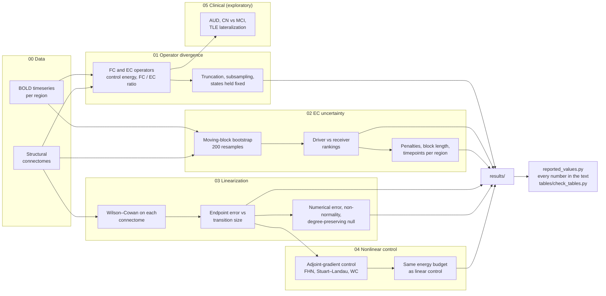

# brain-network-control-sensitivity

[](https://github.com/TheRoy666/brain-network-control-sensitivity/actions/workflows/ci.yml)
[](LICENSE)
[](requirements.txt)
[](#brain-network-control-sensitivity)
[](https://github.com/TheRoy666/NeuroSim)
[](ORIGIN.md)

Code and derived results for

> Roy, R. K., Kothekar, R., Agarwal, K. *How operator specification, estimation uncertainty and linearization shape brain network control.* Manuscript in preparation.

Network control theory turns a model of the brain's dynamics into statements about which regions can steer the network and at what energy cost. Three modeling steps sit between the data and those statements, and the paper measures how much each one moves them:

1. **The operator.** Control energies under functional connectivity and under directed effective connectivity, and how that gap depends on recording length and acquisition.
2. **Estimation uncertainty.** Whether driver-region rankings survive bootstrap resampling of the recording, under two definitions of average controllability that coincide for symmetric matrices and diverge for directed ones.
3. **Linearization.** How far a controller computed from the linearized model misses its target in the nonlinear model it approximates, and what a nonlinear controller achieves within the same energy.

Cohorts: Human Connectome Project (HCP, n = 238), ADNI-3 (n = 49, two parcellations) and the UNAM temporal lobe epilepsy dataset (OpenNeuro ds004469, n = 62).

## Origin

This repository is the paper-specific extract of **[NeuroSim](https://github.com/TheRoy666/NeuroSim)**, the network-control toolkit developed by Ritam Kanti Roy during **Google Summer of Code 2026 with the International Neuroinformatics Coordinating Facility (INCF), project 39**. The paper's analyses were built on NeuroSim and continued beyond it.

What is here is only what the paper uses, arranged as the study runs rather than as it was developed. The NeuroSim package is vendored under the name `nctsens`, so this repository is self-contained and can be installed next to NeuroSim. [`ORIGIN.md`](ORIGIN.md) maps every file to its NeuroSim path, gives its status against a fixed NeuroSim commit, and lists each change made here.

## Study flow



[`docs/STUDY_FLOW.md`](docs/STUDY_FLOW.md) links every result in the paper to the script that produced it, the file it is stored in, and the figure or table that shows it. The repository holds the analyses only; figures were drawn from `results/` and are not part of it.

## Layout

```
src/nctsens/        analysis package (vendored from NeuroSim; see ORIGIN.md)
pipeline/
  00_preprocessing/       containers, regional timeseries, connectomes, QC
  01_operator_divergence/ FC versus EC control energy; recording length
  02_ec_uncertainty/      bootstrap EC, driver rankings, sensitivity sweeps, brain maps
  03_linearization/       linearized versus nonlinear control on connectomes
  04_nonlinear_control/   adjoint-gradient control in three oscillator models
  05_clinical/            exploratory clinical contrasts (Supplementary S1)
  reported.py             shared by the reported_values.py check in each stage
results/            deposited outputs of each stage, pseudonymized
tables/             the published table values and the script that checks them
docs/               study flow, data access, definitions, analysis plans
tests/              unit tests for the package and the brain-map computation
```

Each `pipeline/` stage has a README with its inputs, outputs and commands, and a `reported_values.py` that recomputes every number the paper reports for that stage from `results/` and compares it with the printed value.

## Reproducing the paper

```bash
pip install -e ".[dev]"     # Python >= 3.10; requirements.txt pins the versions used
make test                   # unit tests
make values                 # every number in the text, recomputed from results/ and compared with the paper
make tables                 # Table 1 and Tables S1-S3 from results/, compared cell by cell with the paper
```

These steps need only this repository. Each `reported_values.py` prints the value it recomputes next to the value printed in the paper and lists, at the end, the few numbers that need data not deposited here, with the script that prints them.

Re-running the analyses themselves (`pipeline/`) needs the imaging data, which cannot be redistributed; [`docs/DATA_ACCESS.md`](docs/DATA_ACCESS.md) explains how to obtain each dataset and what was withheld from `results/`.

## Key definitions

The operator convention is x(t+1) = A x(t), so `A[i, j]` is the influence of region *j* on region *i*. Driver rankings use the average controllability of Gu et al. (2015), the trace of the Gramian with input at one region, available as `nctsens.physics.average_controllability(A, direction="driver")`. [`docs/DEFINITIONS.md`](docs/DEFINITIONS.md) sets out this and the other choices the results depend on.

## Citation

Please cite the paper (see [`CITATION.cff`](CITATION.cff)). If you use the toolkit beyond this paper, please also cite NeuroSim.

## License

Apache License 2.0, as for NeuroSim. See [`LICENSE`](LICENSE) and [`NOTICE`](NOTICE).
